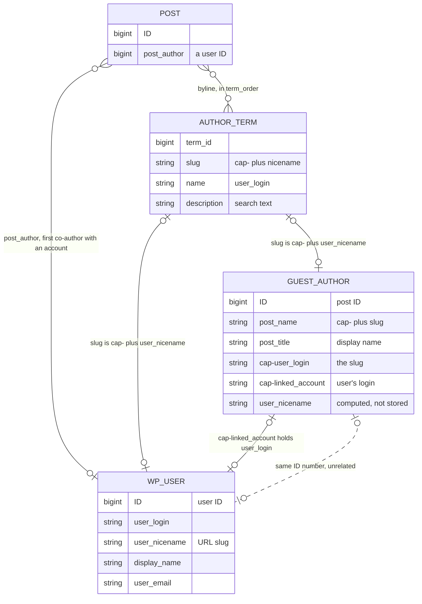
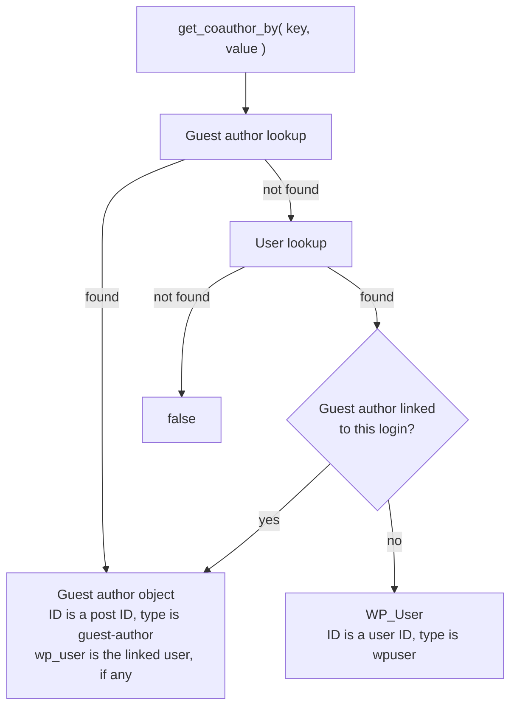

# How co-authors are identified

This page describes how Co-Authors Plus stores and finds a co-author. It's for anyone reading or changing the code, or writing code that looks up co-authors.

Three things make up a co-author:

- **Author term:** the glue. Posts attach to author terms, and a post's terms are its byline. A term holds no profile data, only a copy of the login as its name and search text as its description. The plugin doesn't use term meta.
- **Profile:** who the byline shows, such as the name, biography and avatar. A user's profile is their `wp_users` row and user meta. A guest author's profile is a `guest-author` post and its post meta.
- **Account:** who can act, which means logging in, holding capabilities and being a post's `post_author`. Only a WordPress user is an account.

A **guest author** is a byline whose profile lives in the plugin rather than on a user. Most guest authors have no account. A **linked guest author** borrows one, so the byline shows the guest author's profile and the linked user keeps their login and rights.

## What's stored, and how it joins

There are three real joins: a post to its terms, a term's slug to a nicename, and a guest author's `cap-linked_account` to a user's login. The dashed line is not a join. A user ID and a guest author's post ID come from different tables, so the same number can be two unrelated co-authors.



## The four kinds of co-author

A user with no guest author has one term and is both profile and account. An unlinked guest author has one term, a profile and no account. A linked pair can have one or two terms, depending on whether the guest author's slug matches the user's nicename. `create_guest_author_from_user_id()` can produce either, because it builds the slug from the user's names when it can.


In kind C, both terms resolve to the guest author, and the guest author's archive includes posts on either term.

## A linked pair is one person

Link a guest author to a user when they're the same person. The guest author is their profile, and the user is their account.

- A byline shows the guest author, whichever of the two a post was assigned to, and shows it once if the post was assigned to both.
- Querying by the user's ID or by the guest author's slug finds the same posts, including posts on either term in kind C.
- Only the user can log in or hold capabilities. They can edit posts bylined to the guest author, as far as their role allows.
- Deleting the user deletes the guest author too.

A user should have only one guest author. The **WordPress User Mapping** dropdown enforces that, but `CoAuthors_Guest_Authors::create()` and direct meta writes don't. If two guest authors link to one user, lookups by that user return one of them, and deleting the user deletes only that one.

A few things don't follow this yet:

- `get_coauthors()` returns the user instead of the guest author for a post with no author terms. See [#114](https://github.com/Automattic/co-authors-plus/issues/114).
- `count_user_posts()` counts a linked user's posts twice. See [#928](https://github.com/Automattic/co-authors-plus/issues/928).
- The user's archive only redirects to the guest author's when the user's login and nicename match.

## Same name, different meaning

| Name | WordPress user | Guest author | Author term |
| --- | --- | --- | --- |
| ID | User ID | Post ID | Separate `term_id` |
| Login | Real login | `cap-user_login` meta, which isn't a login | Term name |
| Nicename | Stored, used in URLs | Computed from `cap-user_login` with `sanitize_title()` | Slug without `cap-` |
| Slug | Same as the nicename | **Unique Slug** on the edit screen, which is `cap-user_login` | `cap-<nicename>` |
| Prefixed slug | None | `post_name` | The slug |
| Display name | `display_name` | `post_title` and `cap-display_name` meta | Only in the search text |

A user's login and nicename can differ, for example the login `john.doe` and the nicename `john-doe`. `get_author_term()` also accepts a term whose slug has no prefix.

The `cap-` prefix is used on post meta keys too, under different rules. See `php/class-prefix.php`.

## Looking up a co-author

`CoAuthors_Plus::get_coauthor_by( $key, $value )` tries guest authors first, then users. If it finds a user who has a linked guest author, it returns the guest author, with the user in `$coauthor->wp_user`.



Each key means something different on each side:

| Key | Guest author lookup | User lookup |
| --- | --- | --- |
| `id` | Post ID | User ID |
| `ID` | Post ID | Not accepted |
| `user_nicename` | `post_name` | Nicename, then without `cap-`, then by term name |
| `post_name` | `post_name` | Not accepted |
| `user_login`, `login` | `cap-user_login` meta, then `post_name` | Login, then without `cap-` |
| `user_email` | `cap-user_email` meta | Email |
| `email` | Not accepted | Email |
| `linked_account` | `cap-linked_account` meta | Not accepted |

Some keys look interchangeable but aren't:

- `login` and `user_login` behave the same.
- `id` finds a guest author or a user, while `ID` only finds a guest author.
- `email` only checks users, while `user_email` checks guest authors first.
- `ID`, `post_name` and `linked_account` only find guest authors, so they return `false` when guest authors are turned off. The other keys only check users in that case.

Prefer `user_nicename` for a slug and `user_login` for a login. If you hold a guest author's post ID, use `CoAuthors_Guest_Authors::get_guest_author_by( 'ID', $id )`. Avoid `id`.

The `email` and `post_name` keys are deprecated since 4.3.0. They still work, with a notice when `WP_DEBUG` is on. Use core's `get_user_by( 'email', $email )`, then [look up the link](#writing-code-that-uses-co-authors) if the user might have a guest author, or `CoAuthors_Guest_Authors::get_guest_author_by( 'post_name', $slug )`.

## What a number means to each function

User IDs and guest author post IDs come from different tables, so one number can be both. There's no single rule for a bare number. Each function has its own long-standing behavior, so check before you pass one.

| Function | What it checks | If a user and an unrelated guest author share the number |
| --- | --- | --- |
| `WP_Query` with `author` or `author__in` | User only | User |
| `is_coauthor_for_post()` | User only | User |
| `count_user_posts()` | User only | User |
| `get_author_posts_url()`, `get_author_feed_link()` | User only | User |
| `get_avatar_url()` | User, then guest author | User |
| `get_avatar_url()` with a `user_type` of `guest-user` | Guest author, then user | Guest author |
| `get_avatar_url()` with a `user_type` of `wp-user` | User only | User |
| `CoAuthors_Plus::get_coauthor_by( 'id', $n )` | Guest author, then user | Guest author |
| `get_the_coauthor_meta()`, `the_coauthor_meta()` | Guest author, then user | Guest author |
| `CoAuthors_Plus::get_coauthor_by( 'ID', $n )` | Guest author only | Guest author |
| `CoAuthors_Guest_Authors::get_guest_author_by( 'ID', $n )` | Guest author only | Guest author |

`get_coauthors()` also treats `post_author` as a user ID when a post has no author terms.

These hand out a guest author's post ID, so don't pass it to a function that only checks users:

- `$coauthor->ID` when `$coauthor->type` is `guest-author`
- `coauthors_ids()`
- `get_queried_object_id()` on a guest author's archive

Doing so finds nothing, or another person's posts if a user has that ID. To find a guest author's posts, see [Querying posts](./querying-posts.md#guest-authors-and-supported-post-types). To link to a guest author, pass their nicename too: `get_author_posts_url( $coauthor->ID, $coauthor->user_nicename )`.

## Writing code that uses co-authors

- **Don't treat `$coauthor->ID` as a user ID.** It's a post ID when `$coauthor->type` is `guest-author`. Read the type before passing the ID to anything that expects a user.
- **Get an account from `$coauthor->wp_user` or the object itself.** A `WP_User` is its own account. A guest author has one only if `wp_user` is set.
- **Don't pass a user ID to `get_coauthor_by( 'id', ... )`.** It checks guest author post IDs first, so it can return an unrelated guest author. To find the co-author for a user, look up the link and fall back to the user:

    ```php
    $coauthor = $coauthors_plus->get_coauthor_by( 'linked_account', $user->user_login );
    if ( ! $coauthor ) {
    	$coauthor = $user;
    }
    ```

- **Use `$user->user_login` for the link and `user_nicename` for the term.** They're different values, so passing one where the other belongs only works when they happen to match.

## What sites rely on

Sites, themes and other plugins read these directly, so they stay as they are:

- **Stored data:** the `author` taxonomy, `cap-<nicename>` term slugs, the `guest-author` post type, `cap-*` post meta, and `cap-linked_account` holding a login.
- **PHP:** the objects `get_coauthors()` returns, including `ID` and `type`, `get_coauthor_by()` and its keys, and the [filters](./filters.md).
- **External interfaces:** the [`coauthors/v1` REST routes](./rest-api.md) and author archive URLs.
- **Lookup order:** which side each function and key checks first. See [What a number means to each function](#what-a-number-means-to-each-function).

## Changing how co-authors are found

Themes and plugins depend on what these lookups return, and we can't see their code. So in any release:

- **Keep each function's lookup order.** Don't move a function to a different row of [the table above](#what-a-number-means-to-each-function), or change the order for a key.
- **Don't let existing input reach a different person.** Removing a proven wrong match is fine, and so is a new match that can only find the same person.
- **Don't add a fallback between the two kinds of ID.** If `author__in` tried guest authors when no user matched, a query for a deleted user's ID would start returning an unrelated guest author's posts, and those posts would disappear again once a new user had that ID. The avatar filter's fallback predates this rule and stays, but it isn't a pattern to copy.
- **Say which kind of ID you hold in new code.** Use `get_userdata()` for a user ID and `CoAuthors_Guest_Authors::get_guest_author_by( 'ID', $id )` for a guest author's post ID.

A change that conflicts with this page needs a maintainer's decision first. Don't update the page as part of the fix.
